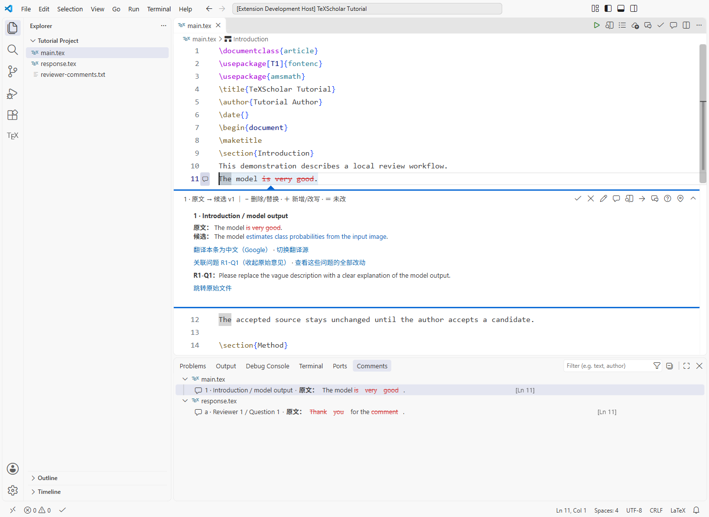
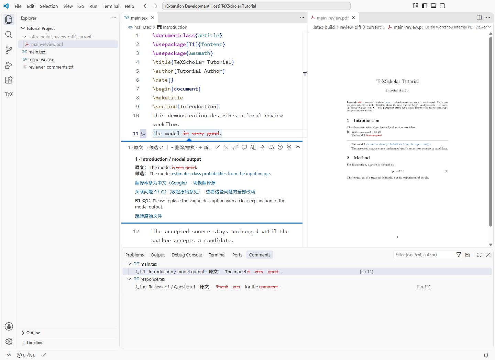
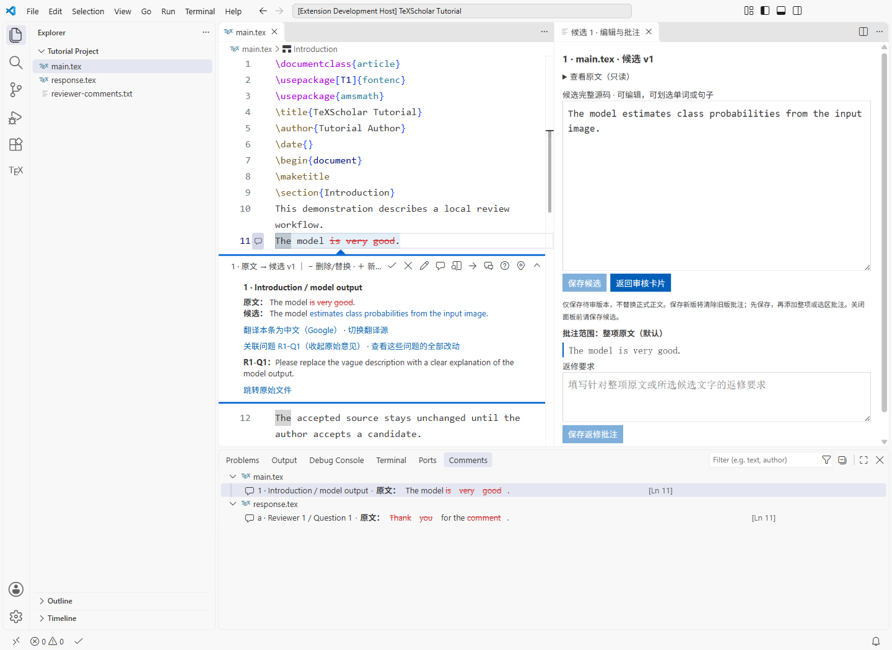
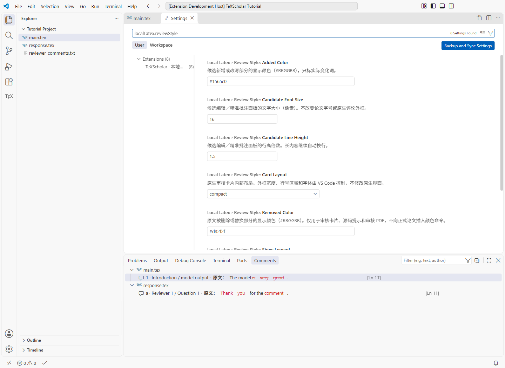

# TeXScholar 使用教程

在本地 VS Code 中写 LaTeX 论文、回复审稿人，并逐处审核 AI 提供的修改。

**第一次使用**：先完成[第一部分：跑通一次修改](#first-run)。已经会用后，再按[第二部分：完整工作流](#workflow)完成整篇论文；需要查按钮或快捷键时，直接看[第三部分：操作手册](#reference)。

> 本教程默认你使用能读取本机文件和执行工具的 Codex。TeXScholar 不包含 AI 模型，也不代替你登录 AI 账号。只在网页里粘贴文字、无法访问本机文件的聊天工具，不能自动完成这里的文件审核流程。
>
> 适用于 Windows 11 与 macOS 的本地 VS Code。macOS 已提供路径和快捷键适配，但尚未完成 Mac 实机验证。不要把浏览器版 VS Code、WSL 或远程文件系统当作相同环境。
>
> 下方截图来自 Windows 隔离演示项目，不含真实论文；VS Code 的界面语言、主题和分栏宽度可以与你不同。截图中的研究描述仅作操作示例。

## 先认识三个角色

全文使用这些标签区分职责：

| 标签 | 谁来完成 | 典型工作 |
|---|---|---|
| **你操作** | 作者本人 | 提供资料、确认逻辑、点击接收、写批注、发送消息、登录账号 |
| **交给 AI** | 你正在使用的 Codex | 检查环境、合并协作规则、阅读论文、生成候选、按批注返修、核对一致性 |
| **插件自动** | TeXScholar 与配套扩展 | 显示卡片、标出差异、保存批注、执行明确的接收、更新预览、按指令备份 |

**请先记住：候选不是正式正文。**

- AI 保存候选后，你能查看新旧对照，但正式正文暂不替换。
- 只有你明确接收，才将对应候选写入正文。
- 保存文件、编译 PDF、保存批注、翻译、整理缩进和 Git 备份，都不等于接收。
- 插件不会因为你写了一条批注，就自动启动 AI。加入 Codex 输入区后，仍由你发送。

## 目录

- [第一部分：第一次使用，跑通一次修改](#first-run)
- [第二部分：完整工作流](#workflow)
  - [写一篇新论文](#new-paper)
  - [修改已有论文](#revise-paper)
  - [回复审稿意见](#response)
  - [审核、返修、再审核](#review-loop)
  - [配置 Git 与私有 GitHub 备份](#git)
  - [结束本批与开始下一批](#batch)
  - [准备投稿文件](#submission)
- [第三部分：操作手册](#reference)
  - [卡片按钮与批注方式](#cards)
  - [普通 PDF、审核 PDF 与双屏定位](#pdf)
  - [中文翻译与代理](#translation)
  - [设置、配套扩展与写作工具](#settings)
  - [快捷键](#shortcuts)
  - [常见问题](#faq)
  - [换电脑、升级与恢复配置](#move)

<a id="first-run"></a>
## 第一部分：第一次使用，跑通一次修改

这一部分先用一个小演示项目体验完整的“AI 出稿 → 你审核 → 返修或接收”。**演练不需要先配置 GitHub。**不要用正在投稿的论文测试首次安装。

### 第 1 步：安装 VS Code、AI 和 TeXScholar

**你操作**：

1. 安装桌面版 [Visual Studio Code](https://code.visualstudio.com/)。
2. 如果使用 Codex，在 VS Code 中安装并登录 Codex 扩展。账号登录、订阅和授权由你自己完成，不向 AI 粘贴密码或令牌。
3. 打开 [TeXScholar 下载页](https://github.com/zlinkw/texscholar/releases)，选择最新一版，展开 **Assets**。
4. 下载名称以 `.vsix` 结尾的插件包。不要把 `source.zip` 或 GitHub 自动生成的 Source code 当成安装包。
5. 在 VS Code 左侧打开**扩展**，点击扩展面板右上角 `…`，选择 **从 VSIX 安装… / Install from VSIX…**，选中下载的文件。
6. 按提示安装必需的 **LaTeX Workshop**。如果市场访问失败，先解决网络或手动装好该扩展，再继续。
7. 如果 VS Code 提示重载窗口，执行重载。

**预期结果**：扩展列表中能看到 **TeXScholar · 本地论文写作与审核** 和 **LaTeX Workshop**。TeXScholar 暂时通过 VSIX 安装，不要因为市场搜索不到名称就认为安装失败。

> 下文说“执行某个命令”，通常指：Windows 按 `Ctrl+Shift+P`，macOS 按 `Cmd+Shift+P`，输入命令的中文名称并选择它。无需在终端输入这些中文。

### 第 2 步：建立一个本地演示文件夹

**你操作**：

1. 新建一个文件夹，例如 `texscholar-demo`。
2. 在 VS Code 使用 **文件 → 打开文件夹**，打开它。不要只打开一个散落的 `.tex` 文件。
3. 确认文件夹是你信任的本地内容后，允许工作区信任。
4. 在文件夹内新建 `main.tex`，粘贴：

```tex
\documentclass{article}
\begin{document}
\section{Introduction}
This demonstration describes a local review workflow.
The model is very good.
The accepted source stays unchanged until the author accepts a candidate.
\end{document}
```

5. 保存文件。

**插件自动**：识别含 `.tex` 的受信任项目，合并适用的写作设置，并显示 AI 协作配置引导。已有明确设置会保留，不整份覆盖你的个人配置，也不改 Typst。

如果本机还没有 TeX 工具，第一次保存可能提示找不到编译器。先做下一步配置，不要反复点击编译。

### 第 3 步：让 AI 完成环境与协作配置

**你操作**：在引导通知中点击 **一键复制提示词**，粘贴到 Codex，检查内容后发送。

没有看到通知时，执行 **复制 AI 协作与跨电脑配置提示词**。

**交给 AI**：

- 检查当前电脑已经安装的工具，复用能用的环境。
- 按需协助安装 Python、TeX 发行版及辅助工具；不要照搬别人电脑的绝对路径。
- 使用插件的 **检查本地写作环境与跨平台工具**，找出缺失项。
- 把协作规则去重合并到它实际使用的全局科研写作 SKILL，让后续“修改论文”“写回复信”自然触发正确流程。
- 读回实际修改的规则，报告安装结果，以及仍需你登录、批准或重载的部分。

**你操作**：处理操作系统安装许可、AI 账号和 GitHub 登录等需要本人完成的步骤。AI 确认实际配置完成后，再点 **已配置，不再提示**；只复制提示词不算完成。

本地工具按用途准备：

| 用途 | 需要什么 | 第一次演练是否需要 |
|---|---|---|
| 编辑与预览 | VS Code、TeXScholar、LaTeX Workshop | 需要 |
| 编译论文 | 一套 TeX Live / TinyTeX / MacTeX，含适用编译器、latexmk、BibTeX、SyncTeX | 需要 |
| 候选审核与审核 PDF | Python 3.12 或更新的 Python 3、latexdiff，以及可用的 TeX / Perl 环境 | 需要 |
| 整理源码缩进 | tex-fmt | 用到时需要 |
| 备份到私有 GitHub | Git、GitHub CLI，以及你自己的 GitHub 登录 | 可以稍后配置 |
| 英语检查、书签等 | 对应的配套扩展 | 可选 |

首次轻量安装可选 [TinyTeX](https://yihui.org/tinytex/)。已经有可用 TeX Live 或 MacTeX 时，不必重复安装另一套。插件不内置整套 TeX 或 Python，也不会自动替你登录账号。

如果 AI 没有全局 SKILL 写入能力，应让它明确说明限制；不能因为它说“记住了”，就假定其他会话也已配置。

### 第 4 步：先编译普通 PDF

**你操作**：打开 `main.tex`，按 `Ctrl+S`；Mac 按 `Cmd+S`。

**插件自动**：保存并交给 LaTeX Workshop 编译当前主文档。首次需要安装缺失宏包时，按 TeX 发行版提示处理，或把完整错误交给 AI。

**你操作**：执行 **打开编译后的 PDF（右侧预览）**，或按 `Ctrl+Alt+V`；Mac 为 `Cmd+Option+V`。

**预期结果**：普通 PDF 中能看到 `Introduction` 和三句示例文字。先确保这一步成功，再尝试审核 PDF。

> `main.tex` 只是本教程的示例文件名，不是插件强制要求。独立文档可自动识别；分章节项目需要识别真实主文档，不能把每个 `\input` 子文件都当作能单独编译的论文。具体见[主文档与编译](#compilation)。

### 第 5 步：让 AI 只生成一处候选

**你操作**：在 Codex 发送：

```text
请读取当前电脑的 TeXScholar 写作指南和已配置的科研写作规则，检查这个本地演示项目。

这只是操作演练，不是真实科研结论，也不存在真实审稿意见，不要编造问题关联或实验结果。
请把 “The model is very good.” 改为
“The model estimates class probabilities from the input image.”

首次需要时建立唯一的本地审核状态。只保存一处待审候选，不接收、不替换正式正文，不操作 Git。
已有状态则复用，不要为这一次修改反复开始新批次。
完成后告诉我实际候选编号和位置。
```

**交给 AI**：读取文件、建立必要的审核状态，并通过当前插件提供的审核工具保存候选，而不直接覆盖原句。

**插件自动**：检测状态变化，在原句旁显示评论按钮，并在底部**评论 / Comments**中列出候选。

**预期结果**：AI 报告一个真实存在的候选编号，通常首次正文为 `1`。如果它只在聊天里贴了改写文字，却没有产生卡片，让它继续按插件工具保存待审候选。

### 第 6 步：在原文件里查看新旧差异

**你操作**：点击原句左侧的评论按钮，或点击底部评论列表中的对应条目。不必另开 Git diff 窗口。

**插件自动**：展开这一处审核卡片，显示原文和候选。默认只为实际不同的词显示删除线或新增颜色，相同词保持普通样式。



**图中怎么看**：

- 源文件行左侧的气泡用于打开卡片。
- 卡片顶端的 `1` 是正文候选编号，`v1` 是当前候选版本。
- **原文**是接收前的内容，**候选**是尚未接收的新内容。
- 截图还演示了审稿问题关联；你的首次单句演练可以没有这部分。
- 底部评论列表是导航，不是另一份论文，也不是要求你再审核一遍的副本。

如果卡片没有出现，执行 **显示或刷新原文审核与评论**，或按 `Ctrl+Alt+R`，并确认你打开的是同一演示文件夹。

### 第 7 步：生成完整审核 PDF

**你操作**：在卡片工具栏点击 **生成／更新完整论文审核 PDF（首次新窗口）**；不确定图标时悬停查看名称。也可在 LaTeX 编辑区按 `Ctrl+Alt+D`，Mac 为 `Cmd+Option+D`。

**插件自动**：生成一份完整论文的审核 PDF，首次放到浮动预览窗口，便于移到第二块屏幕。正文上下文仍保留，修改处展示原句、分隔线和候选句。



**预期结果**：普通 PDF 仍是接收前的正文；审核 PDF 能看到待审改写。**生成审核 PDF 不代表接收候选。**

截图为了展示两边的对应关系使用同窗分栏。日常可以保留默认浮窗，或使用 VS Code 原生标签菜单把 PDF 移回主窗口。

### 第 8 步：接收，或者批注返修

选一种方式完成这一轮：

| 你的判断 | 你操作 | 插件自动 | 是否需要 AI |
|---|---|---|---|
| 满意 | 点击 **接收本项并替换正文**，通常为 `✓` 图标 | 精确替换原句，移到下一待审项；存在审核 PDF 时按默认设置后台更新 | 不需要再次请求 AI 替换 |
| 大致满意，只想自己改几个词 | 点击铅笔 **编辑候选／划词精确批注**，改文字并保存候选，再回卡片接收 | 保存新版待审内容，不替换正式正文 | 可以不经过 AI |
| 不满意，希望 AI 改 | 在卡片添加返修批注，或在候选编辑面板里划词批注 | 保存本地要求，不启动 AI | 之后把批注加入 Codex 输入区，由你发送 |
| 这项不需要了 | 点击 **拒绝本项候选并保留原文**，通常为 `×` 图标 | 结束本项待审，原文不变 | 不需要 |

**想返修时，不要先点拒绝。**“拒绝”与“请按我的批注改一版”是两种不同决定。

一次返修演练可以这样做：

1. 点击铅笔，找到候选文本。
2. 选中 `class probabilities`，在返修要求中写“请改为更容易理解的说法，并说明输出是什么”。
3. 点击 **保存返修批注**。
4. 执行 **把全部批注加入 Codex 输入区（不发送）**。
5. 切到 Codex，核对输入区中的编号、原版、候选和批注，然后自己发送。
6. AI 保存同编号的新版候选后，卡片自动更新。重新审核，满意再点接收。



原生评论正文没有供插件捕获鼠标选区的接口。**要对候选里的具体词句批注，请在这个候选编辑面板中选，不是在只读卡片里拖选。**

### 第 9 步：确认你已经跑通

**你操作**：接收后回到 `.tex`，确认原句已变为候选文字；需要普通 PDF 时保存编译。

现在你已完成一次“生成候选 → 查看卡片和审核 PDF → 接收或返修”的流程。

如果尚未设置 Git，**先不要用“开始新批次”来清空记录**。新批次会保护尚未备份的已接收成果。继续到[Git 备份](#git)完成配置，再按[结束本批](#batch)保存成果。

<a id="workflow"></a>
## 第二部分：完整工作流

以下三个场景最终都进入同一个审核循环，不需要三套不同的操作方式。

<a id="new-paper"></a>
### 场景一：写一篇新论文

#### 1. 提供素材，而不是让 AI 凭空成稿

**你操作**：打开一个本地论文文件夹，准备实际期刊模板、研究说明、可核验的实验结果、图表和参考文献。可以附上你最满意的论文或段落，说明希望学习的是逻辑、语气还是结构。

可以发送：

```text
我要在当前本地项目写一篇新论文。
请先读取 TeXScholar 最新写作指南、我的全局科研写作规则和项目中的实际资料。

目标期刊：填写期刊名称。
研究问题与真实方法：填写说明或指明文件。
实际实验结果：指明已有结果文件；缺少的证据明确列出，不编造。
参考资料：指明我希望参考的论文或段落。

先讨论问题、挑战、方法与实验证据如何对应，并给出章节组织方案。
不要直接写完整论文。方案由我确认后，再分小批保存待审候选。
```

#### 2. 确认组织方案和长期规则

**交给 AI**：检查资料，提出必要问题，给出中文逻辑安排，并指出哪些论断仍缺证据。

**你操作**：确认关键逻辑、术语、语气、篇幅和期刊要求。

**交给 AI**：把你确认的全篇要求写到源文件顶部的规则注释，把各段的目的和衔接安排写在对应段落前。不要把聊天中的临时安排误当作你已经确认的要求，也不要另建一堆项目管理 Markdown 文件。

**插件自动**：允许折叠规则和计划注释；不会把这类交接状态当成作者需要接收的正文修订。

#### 3. 分批撰写与审核

**你操作**：明确本次范围，例如“先写摘要与引言第一段，其他部分先不动”。

**交给 AI**：保留期刊模板结构，新写和实质改写的普通正文一句一行，使用本地待审候选交付。新建必要文件骨架与接收正文是不同操作，应按你授予的范围执行。

**你操作**：使用[统一审核循环](#review-loop)接收、手改或返修。确认这一部分后再写下一部分，避免同时堆出整篇无法细看的候选。

书写公式、图表和参考文献时，可以要求 AI 协助，但插件不验证科学结论真假。图表要来自实际材料，引用要核对原始来源，不能把自动补全当成文献真实存在的证明。

<a id="revise-paper"></a>
### 场景二：修改已有论文

#### 1. 先让 AI 读当前真实版本

**你操作**：打开论文根文件夹，保存现有手动编辑，说明要改什么、哪些部分不要动。

```text
请基于当前真实源文件修改，不沿用聊天里可能过期的论文版本。
本轮范围：填写章节或问题。
必须保留：填写已有术语、结论、数据、结构等。

先读当前作者注释和唯一审核状态。
只对本轮范围生成待审候选，不直接替换正文，不接收、不提交或推送。
相邻修改按位置组织，最多一个自然段；公式、图注和表注单独处理。
同一位置涉及多个问题时综合成一项，不生成重叠候选。
最后简要说明实际编号、位置与修改目的。
```

**交给 AI**：先核对现有手动修改、待审候选和作者要求，再提出必要改写。

#### 2. 按位置审核，而不是按问题重复改同一段

同一段可能同时回应多个审稿意见，但通常只需要一套最终措辞。候选应按原文位置组织，再关联全部相关问题；不要让多个候选反复覆盖同一句。

卡片可以包含邻近的几句改写，但最多一个自然段。审核 PDF 则进一步只对照真正改变的句子；未改句和未改公式不会为了凑成整段而重复展示。

#### 3. 保存并继续

**你操作**：接收满意部分，未满意部分留批注，进入[统一审核循环](#review-loop)。不需要先建立 Git diff 才能审稿；Git 是成果备份工具，不是候选审核的前提。

<a id="response"></a>
### 场景三：回复审稿意见

#### 1. 准备可核对的原始意见

**你操作**：提供手稿、真实原始审稿意见，以及你希望模仿语气和格式的回复信参考。

- 保留审稿人的原始编号与完整措辞，不用自己的摘要替代原始问题。
- 意见已经在回复信 `.tex` 中时，可以直接使用，不必复制另一套问题表。
- 原件是 PDF 或 Word 时，可以让 AI 提取并由你核对文字；精确跳转需要项目内真实存在的 UTF-8 `.tex`、`.txt` 或已有 `.md` 文本。
- 不要要求插件假装能在任意 PDF / Word 中精确跳到对应句子。

#### 2. 先确定如何回应，再生成改稿与回复候选

**你操作**：发送：

```text
请协助处理当前论文的审稿意见，并遵循 TeXScholar 最新协作规则。
先读真实手稿、全部原始意见、现有回复信和作者注释。

先说明每个问题需要改手稿、补证据，还是只需在回复中解释，必要时向我提问。
需要改手稿时先生成手稿候选，再基于对应内容写回复候选；没有必要的正文修改不要强造。
未被我接收的改动只能称为拟议修订，不要写成已经完成。

同一原文位置综合相关意见，只生成一个候选，并关联所有实际对应的原始问题。
关联必须来自真实文件中的唯一精确摘录，不按候选编号或相邻位置猜配。
```

**交给 AI**：保存手稿候选与回复候选，并建立经核对的原始问题关联。原始意见、回复语气、文件定位和实际修改范围应一致。

**插件自动**：正文使用数字，如 `1、2、3`；回复使用字母，如 `a、b、c`。审稿问题使用 `R1-Q1` 一类身份编号，与候选编号不是同一套东西。

| 显示内容 | 表示什么 |
|---|---|
| `1`、`2` | 本批正文候选 |
| `a`、`b` | 本批回复信候选 |
| `v1`、`v2` | 同一候选的不同待审版本 |
| `R1-Q1` | 原始审稿问题的身份；示例为审稿人 1 的第 1 个问题 |

#### 3. 从回复反查手稿是否真的改了

**你操作**：

1. 在回复信中打开对应候选卡片。
2. 查看默认展开的关联原始问题，必要时点击 **跳转原始文件**。
3. 点击 **查看这些问题的全部改动**，查看关联的正文与回复条目，再跳转逐项核对。
4. 结合实际手稿判断问题是否得到回答，不仅检查回复信是否写得礼貌。

**插件自动**：按照已经核实的关联导航，不会因为关联齐全就判断科学问题已经解决。

#### 4. 关联缺失或错误时，交给 AI 修正

**你操作**：在关联异常通知中使用 **一键复制给 AI**，粘贴后发送。也可以直接说：

```text
请核对候选 1、a 的原始问题关联。
读取当前候选和实际原始意见，使用元数据更新接口补充或纠正关联，不改候选措辞，不接收候选。
需要替换整组关联时先说明替换范围，禁止自动猜配。
```

你不需要手写问题映射 JSON，也不要手改源文件中的压缩状态记录。正常关联不反复弹通知。

#### 5. 最后核对回复与已接收正文

**交给 AI**：在作者接收相关改动后，重新核对回复中的术语、数值、引用、摘录、章节和修改描述。页码、行号应来自实际编译版本；没有编译依据时用章节与标签，不编造精确行号。

**你操作**：决定答复是否充分，尤其是实验补充、证据限制和不采纳意见的理由。接收一条文字修改，不等于宣布该科学问题闭合。

<a id="review-loop"></a>
### 三个场景通用：审核 → 返修 → 再审核

#### 1. 开始本轮前

**你操作**：说明这轮希望修改的内容。准备离开前，先保存手动编辑的候选或批注。

**交给 AI**：读取当前项目，不依赖聊天缓存中的旧稿；复用正在进行的批次。只有你明确要求新批次，才执行新批次准备。

#### 2. 按卡片逐处决定

你可以交替使用：

- 原文件中的审核卡片：看精准改动，直接接收、拒绝或批注。
- 候选编辑面板：手动调整候选、划词写要求。
- 完整审核 PDF：结合排版和上下文判断改写是否合适。

插件执行接收后自动打开下一个待审项。到最后一个结束时，不自行宣布整批审完。

#### 3. 批注分三种常见用法

| 你想表达什么 | 在哪里操作 | 具体做法 |
|---|---|---|
| 整项需要重写 | 卡片批注按钮，或候选面板 | 不主动选词，直接填写要求；默认针对本项原文，仅补充项没有原文时针对候选 |
| 原文中的某些词需要解释 | 原 `.tex` 编辑区 | 选中真实源文件中的词句，再点对应卡片的批注按钮 |
| 候选中的某个词句不满意 | **编辑候选／划词精确批注**面板 | 在候选文本框内选择准确词句，再填写要求 |

**保存返修批注**只存本地要求。要请 AI 修改，再执行 **把全部批注加入 Codex 输入区（不发送）**，核对后发送。

如果你刚手动改过候选，先点 **保存候选**，再选择新版本中的文字写批注。不要用旧版本的选区标注新版本。

#### 4. 把整批要求交给 AI

**你操作**：点击加入 Codex 的按钮，检查输入区中的候选编号、位置、原版、当前候选、选区和要求，然后补充总要求并发送。例如：

```text
请处理刚加入输入区的返修批注。
先读取当前真实候选版本和对应原文，按我的要求修改未接收候选。
保持编号和原文定位，不替换正式正文，不接收，不操作 Git。
本次新版可以替换旧待审措辞和旧批注，我会重新审核。
完成后说明哪些编号已更新，哪些需要我补充信息。
```

**交给 AI**：保存同编号的新版候选。旧批注可以随授权返修重置，不要求你先逐条接收或拒绝旧稿。

**插件自动**：检测实际文件变化，只更新受影响的卡片。未保存的手动候选编辑不会被悄悄覆盖；有冲突时由你选择如何载入新版。

#### 5. 再审核，而不是认为 AI 已代你接收

**你操作**：重新检查新版内容，满意才接收。不满意可以继续批注，或自己编辑候选。

对于仍然保留的待审项，不需要为了备份已经满意的其他项而先作出接收决定。结束审核后的处理见[每批成果](#batch)。

<a id="git"></a>
### 配置 Git 与私有 GitHub 备份

Git 记录已经认可的成果，不承担这里的卡片审核。**没有 Git 也可以先写作、看候选和生成审核 PDF。**但要使用自动成果检查点和安全开启下一批，需要先完成备份配置。

TeXScholar 的公开插件仓库不是你的论文备份仓库。论文应使用你自己授权的私有仓库，不要把手稿推送到插件仓库。

#### 1. 第一次初始化，明确交给 AI 的范围

**你操作**：确定当前论文根目录和私有仓库名称；把下面的占位内容换成你的实际选择，再发给 AI：

```text
请为当前本地论文项目配置 Git 成果备份。
我授权为这个论文项目建立本地 Git 仓库，并在我的 GitHub 账号下创建名为【填写仓库名】的私有仓库。
若已经有本地仓库或 origin，先读取并核对，不重建、不改指向、不覆盖历史。

保留当前手动编辑和暂存选择。
先完善忽略规则，排除审核对象、临时预览、编译缓存、日志和凭据，再建立必要的初始源码备份。
保留正文、回复信、参考文献、图片、PDF 矢量图、期刊类文件和模板资源。
按当前 TeXScholar 的源码快照规则备份，不上传未接收候选、批注和运行状态数据。
核实远端确实为私有，使用正常提交与推送，不强推。
需要 GitHub 登录时让我本人操作，最后报告实际本地与远端状态。
```

**交给 AI**：检查现状，创建或核对本地仓库、忽略规则、私有远端和首个可用备份。

**你操作**：完成 GitHub 本人登录、浏览器授权或系统凭据提示。不要把 Token 贴进论文、README 或给 AI 当正文处理。

**插件自动**：不会因为安装插件就替你创建仓库；首次创建私有远端仍需要项目级授权。以后备份时会核对已配置远端。

#### 2. 忽略规则要避免误伤论文素材

生成内容通常集中在以下目录，应排除备份：

```gitignore
.codex-review/
.latex-build/
__pycache__/
*.pyc
.DS_Store
Thumbs.db
```

让 AI 按实际项目补充其他生成文件，**不要简单写 `*.pdf`**：论文图片、示意图或模板附件本身可能就是必须保留的 PDF。

如果缓存已经被 Git 跟踪，仅添加 `.gitignore` 不会把它从历史和跟踪中移除。应交给 AI 检查并说明处理范围；不要自己点“全部暂存”来尝试解决。

#### 3. 区分两个备份入口

| 入口 | 什么时候使用 |
|---|---|
| **Git 备份论文项目（提交并推送到私有 GitHub）** | 普通项目源码备份；先核对实际改动范围 |
| **本轮审完：提交已接收成果并推送私有 GitHub** | 正在使用候选审核时的成果检查点；只记录本批新接收成果 |

审核期间优先用第二个入口。不要用普通“全部提交”绕过候选、批注和源码快照的区分。

<a id="batch"></a>
### 结束本批与开始下一批

#### 1. 什么叫“一批审完”

指你已经看过本批条目并给出了本轮处理意见，不要求每一项都已经满意。

**你操作**：明确对 AI 说“本轮审核完成／本批审完”，或执行 **本轮审完：提交已接收成果并推送私有 GitHub**。

打开卡片、保存文件、写了很多批注或浏览完 PDF，都不会替你触发这个判断。

#### 2. 结束后各自做什么

| 谁 | 应完成什么 |
|---|---|
| 你 | 明确结束本批的这一轮审核 |
| AI 或结束审核操作 | 核对当前已接收成果，调用当前备份流程；不是另用 `git add .` 绕过审核 |
| 插件／备份工具 | 只提交本批新增的已接收成果，推送已配置且已核实为私有的 GitHub |
| 插件／备份工具 | 推送成功后精简完结记录，并清理经引用核验确认不再需要的对象缓存 |

提交说明应写清修改目的、相关编号和文件范围，方便日后按问题查找，而不是只写“update”。

**保留与失败行为**：

- 未接收候选和返修批注继续保留本地，不上传，不阻塞其他已接收成果的备份。
- 本批没有新接收成果时，不创建空提交。
- 推送失败时不清理。先解决登录、网络、远端或冲突，再继续。
- 遇到混合手动修改、已有暂存选择或无关待推送提交，工具可能要求先核对；不要强推、重置或清空暂存来绕过。
- 成果备份与缓存清理成功，不代表审稿问题科学上已经解决。

#### 3. 继续返修，还是明确开始新批次

**继续处理剩余候选**：直接让 AI 按现有批注返修，保留当前批次和编号。

**确实要丢弃剩余草稿、开始新一批**：明确告诉 AI。例如：

```text
本批已接收成果先核对并完成私有 GitHub 备份。
成功后开始新的审核批次；我允许废弃上一批剩余未接收候选及批注，不要求迁移旧草稿。
保留正式正文、手动编辑、作者科研要求、原始意见、参考文献和图表。
新批次正文从 1、回复从 a 开始。未备份成功不要清空或重建。
```

**注意：未接收草稿和批注没有随成果备份上传，不能承诺以后从 Git 恢复。**重启 VS Code 只恢复当前批次，不自动创建新批次或重新编号。

<a id="submission"></a>
### 准备投稿文件

**你操作**：确认哪些结果已接收，哪些候选不应进入投稿稿件，并提供期刊要求。

**交给 AI**：

1. 基于已接收正文准备独立投稿副本，不把审核 PDF 当投稿 PDF。
2. 核对主文件、引用、图片、表格、参考文献及期刊要求的源码依赖。
3. 检查回复信中的修改描述与最终稿一致。
4. 需要移除工作注释或生成提交包时，在独立副本中处理，保留工作目录的作者要求、状态和批注。
5. 报告仍未验证的内容，让你最终确认。

**你操作**：编译并核对最终 PDF，检查期刊格式、匿名要求和提交清单，再本人上传。插件不自动向期刊投稿，也不把“准备投稿”理解成接收全部剩余候选。

<a id="reference"></a>
## 第三部分：操作手册

<a id="cards"></a>
### 卡片按钮与批注方式

卡片工具栏比较紧凑。**悬停图标可看完整中文名称**；分栏很窄时，也可从命令面板执行同名操作。始终先核对当前卡片编号，再点击操作。

| 按钮／命令 | 用途 | 会替换正式正文吗 |
|---|---|---|
| `✓` 接收本项并替换正文 | 接收当前候选，随后打开下一待审项 | **会，仅当前项** |
| `×` 拒绝本项候选并保留原文 | 不采用当前候选 | 不会 |
| 铅笔：编辑候选／划词精确批注 | 手动修改候选或选择候选中的具体词句 | 保存候选不会；仍需接收 |
| 气泡：添加返修批注 | 针对当前原文或源编辑器选区写要求 | 不会 |
| 生成／更新完整论文审核 PDF | 看完整论文中的修改效果 | 不会 |
| 箭头：下一项原文审核 | 移到下一个待审项 | 不会 |
| 把全部批注加入 Codex 输入区 | 汇总原版、候选、选区和返修要求，供你发送 | 不会，也不自动发送 |
| 问题：查看／收起关联的原始审稿意见 | 展开原始问题，并查看相关改动 | 不会 |
| 定位：定位到审核 PDF 中的当前修改 | 跳到已生成审核 PDF 的对应位置 | 不会 |
| 展开完整源码（含注释） | 查看卡片中未展开的完整 TeX 与注释 | 不会 |

默认图例中，删除或替换的原词显示删除线，新增或改写显示新增颜色，相同文字不标成改动。公式可能仅标色、不加删除线，以便保持公式可读。颜色可以改，含义不变。

**仅补充**：原文没有对应句子，会明确标“仅补充／无对应原句”，不是加载失败。

**仅删除**：会说明删除，并提供删除后的衔接预览；这段衔接文字只是上下文预览，不代表它也会被替换。

**同一行多个候选**：可能共用一个原生评论框。看标题中的本行编号，再使用 **选择本行编号** 切换，避免把同一框误认为永远只有一个候选。

<a id="pdf"></a>
### 普通 PDF、审核 PDF 与双屏定位

#### 普通 PDF 与审核 PDF 有什么区别

| 项目 | 普通 PDF | 审核 PDF |
|---|---|---|
| 内容来源 | 当前实际 `.tex` 正文 | 实际正文加待审候选的阅读对照 |
| 用途 | 查看当前正式内容与排版 | 评估还未接收的修改 |
| 生成方式 | 保存编译或执行编译命令 | 首次手动生成／更新审核 PDF |
| 能否直接投稿 | 仍需按期刊检查 | **不能当作投稿稿件** |
| 接收候选后的更新 | 保存编译后反映新正文 | 已存在预览时默认后台自动更新 |

审核 PDF 中，编号与关联问题占一行；原文在上，灰线以下是候选。未改内容保留一次，仅改动句上下对照。一个候选在同一段有多处改变时，PDF 可以多处显示同一编号，不代表多生成了候选。

| PDF 提示 | 意义 |
|---|---|
| `Within paragraph` | 原段落内部修改 |
| `Inline addition` | 在原段落内部补句 |
| `Paragraph rewrite` | 整段改写 |
| `New paragraph` | 新增段落 |
| `¶` | 真实段落起点，不是源码里每次换行 |
| `Addition only` | 仅补充，没有对应原句 |
| `No linked question` | 尚未关联审稿问题；普通写作可以没有审稿问题 |

#### 怎样更新与重新打开

- **第一次看审核 PDF**：点击生成按钮，等待编译成功。
- **候选发生变化**：再次点击同一生成／更新按钮。
- **接收候选**：默认自动更新已经生成的审核 PDF；可在 `localLatex.reviewPDF.autoUpdateAfterAccept` 关闭。
- **只是关了预览窗口**：执行 **重新打开已有审核 PDF 窗口（不编译）**，不必再生成一遍。
- **只写了批注、打开了卡片或收起内容**：不会因此编译 PDF。

初次编译、缺宏包或实际引用／分页变化时可能较慢。编译失败不会用失败产物覆盖上一次成功预览；看到旧 PDF 时，要先检查本次生成是否成功。

#### 双屏怎么摆

**你操作**：把默认打开的浮动 PDF 窗口拖到第二块屏幕，主屏保留源码和卡片。

普通正文或回复信 PDF 也可以在主窗口文件树中右键，选择 **在双屏浮动窗口打开 PDF（与主窗口共享定位）**。

不要为了双屏重新打开一套相同论文工作区。使用浮动编辑器窗口即可共享当前项目；需要移回主屏时使用 VS Code 原生标签／窗口操作。

#### 如何双向定位

- **源码到普通 PDF**：光标放在真实 `.tex` 中，执行 **定位 PDF 中光标对应的位置**，或按 `Ctrl+Alt+J`；Mac 为 `Cmd+Option+J`。
- **卡片到审核 PDF**：点击卡片上的 **定位到审核 PDF 中的当前修改**。它定位审核快照，不是普通 PDF。
- **PDF 回源码**：在 Workshop PDF 中双击对应文字。审核 PDF 的原文与候选都定位回真实源文件中的修订位置，而不是让你编辑生成副本。

定位需要成功编译时生成的 SyncTeX 信息。候选已更新但审核 PDF 仍是旧版本时，应先更新预览；不要依据旧 PDF 猜当前行号。想改候选，仍回卡片的候选编辑面板操作。

<a id="translation"></a>
### 中文翻译与代理

**你操作**：在卡片内点击 **翻译本条为中文**。原文、候选和关联审稿意见各自在对应位置展开中文，再次点击可收起或展开。

- 只发送你点击的这一项所需文字，不自动翻译整篇论文。
- 原文、候选或问题摘录各自完整请求，不因每 500 字符而自动增加请求。
- 相同来源、相同文字的成功译文可以在仍有效的卡片之间复用；同一个审稿问题被多个候选引用时，不必每次重复请求。
- 译文只辅助阅读，不写回论文、候选、审核状态或 Git，不触发接收或 PDF 编译。
- 公式与引用标记尽量保留；若还原不完整，会显示阅读提示，仍应对照原文判断。

点击 **切换翻译源**，或在设置中搜索 `localLatex.translation.provider`：

| 来源 | 使用方式 |
|---|---|
| Google | 默认来源，无需另配密钥；默认读取系统代理 |
| Google（googleapis） | 另一个可手动选择的 Google 入口；不是需要密钥的 Google Cloud API |
| Bing／微软 | 无需另配密钥的微软翻译入口 |
| DeepL | 无需另配密钥的第一方网页接口 |
| 腾讯 TranSmart | 无需另配密钥的腾讯网页接口 |

Google 两个入口默认读取当前 Windows／macOS 系统的静态 HTTP／HTTPS 代理，系统没有启用代理时直连；不把某个用户的代理端口写死。其他来源保留 VS Code 中明确的代理选择，未指定时跟随系统。这里不执行 PAC 自动代理脚本。

**429 不等于你点得太多，也不等于已确认没挂代理。**匿名服务可能限流或临时拒绝请求；Google 可能出现时好时坏的情况。失败后会保留已经完成的部分，你可以稍后点“重试未完成翻译”，或自己换源；不会自动换供应商、轮换 IP 或连续重试。不要把一次成功当成永久稳定保证。

翻译会把本条文字交给所选服务。对于不能外发的未发表内容，请不要点击在线翻译；显示翻译也不能代替核对审稿人的真实原话。

<a id="settings"></a>
### 设置、配套扩展与写作工具

#### 从哪里打开设置

**你操作**：打开 VS Code 设置，搜索 `localLatex`；也可以在命令面板执行 **打开设置(UI)** 后搜索。

不要把本教程中的设置键当成必须手写到文件里的代码。优先通过设置界面修改。



| 想调整什么 | 搜索什么 | 会影响什么 |
|---|---|---|
| 是否自动配置 | `localLatex.configurationProfile` | `full` 完整合并；`latex-only` 只补齐 LaTeX 项；`off` 不自动导入 |
| 接收后是否自动更新审核 PDF | `localLatex.reviewPDF.autoUpdateAfterAccept` | 只控制已生成审核 PDF 的自动更新 |
| 删除与新增颜色 | `localLatex.reviewStyle.removedColor`、`addedColor` | 审核显示，不修改论文源码 |
| 未改文字颜色 | `localLatex.reviewStyle.unchangedColor` | 留空跟随原有颜色 |
| 删除线、图例与紧凑布局 | `localLatex.reviewStyle.strikeDeleted`、`showLegend`、`cardLayout` | 卡片与适用的审核显示 |
| 候选编辑面板字号和行高 | `localLatex.reviewStyle.candidateFontSize`、`candidateLineHeight` | 不改变期刊论文排版字号 |
| 翻译来源 | `localLatex.translation.provider` | 由你明确选择本条内容发给哪家服务 |
| Python 或工具位置 | `localLatex.pythonPath`、`latexmkPath`、`latexdiffPath`、`texFmtPath` 等 | 仅指定本机实际安装的工具 |

显示颜色不是写作指令。不要因此让 AI 在正式正文插入一堆颜色或删除线宏；期刊要求的正式修订标记另行处理。

原生评论外框的位置与宽度由 VS Code 管理，不能承诺与第 1 列光标精确对齐。完整配置会建议取消评论内部高度限制，长内容随编辑区滚动；已有明确选择仍会保留。

#### 自动配置何时发生

- 含真实 `.tex`、受信任的本地项目会触发配置。
- 没有 `.tex` 的代码项目和纯 Typst 项目不触发。
- 已有明确偏好优先，完整方案也不整份覆盖你的设置。
- 完整方案包含部分全局显示偏好，例如评论高度、文件嵌套和搜索排除；不只影响某一个编辑标签。
- 主题、账号、凭据、代理和 Typst 配置不作为整套预设复制。

想重新导入，执行 **导入／重新应用论文写作配置**。不要为了某一项不符合预期，直接选择覆盖所有冲突；先看该项是否已有你自己的设置。

#### 可选扩展怎么选

执行 **安装缺少的配套扩展**，按用途勾选；不是必须全装。

| 用途 | 配套扩展 |
|---|---|
| 编译、PDF 与双向定位 | LaTeX Workshop，必需 |
| 英语拼写与语法 | LTeX+ |
| 把诊断显示在行内 | Error Lens |
| 书签与长文导航 | Bookmarks |
| 按注释标签浏览任务 | Todo Tree |
| 数学输入、矩阵操作 | LaTeX Suite |
| 输入时查看公式效果 | Ultra Math Preview |
| 表格／图片转换粘贴 | LaTeX Utilities |
| 可视化编辑 | LaTeX Visual Editor，可选 |
| 界面中文化 | Chinese (Simplified) Language Pack |
| 源码悬浮翻译 | Comment Translate，可选；与卡片翻译是两个入口 |

系统工具和账号仍由各自程序管理。比如英语检查器可能还需要下载语言服务器；扩展装好不等于所有依赖已经就绪。

#### 章节目录、折叠和书签

- 使用 LaTeX Workshop 的结构树／大纲浏览章节、图表和标签，点击条目定位源文件。
- 需要把结构树放到资源管理器时，用 VS Code 原生“移动视图”操作；插件不替你强行摆放整个界面。
- 长文中添加书签后，可按前一个／下一个书签跳转，或列出全部书签。
- **折叠写作规则与段落计划**仅折叠显示，不删除科研注释。
- 注释、书签和结构树用途不同：不要为了有一个任务列表，再复制第二份问题状态文件。

#### 一句话一行与整理缩进

**交给 AI**：新写或实质改写的普通正文一句一行，段内不插空行，段间保留真实段落分隔。数学、小数和缩写不能机械按句号拆。

**你操作**：需要时执行 **整理缩进并保存（不改正文，不操作 Git）**，或按 `Ctrl+Alt+L`；Mac 为 `Cmd+Option+L`。

整理缩进不会替你重新组织整篇论文的句子，也不会自动提交 Git。日常保存编译与手动缩进是不同操作，不需要每次保存都格式化。

#### 橙色警告怎样处理

将鼠标移到有诊断的文字上，查看原因与可用操作：

| 操作 | 含义 |
|---|---|
| 接受建议 | 对当前可安全自动修复的建议应用修复 |
| 接受全文此类建议 | 对当前文件同类、可自动修复的问题应用修复，之后核对结果 |
| 忽略本行警告 | 只忽略当前行适用的检查警告 |
| 忽略全文此类警告 | 在当前文件忽略这一类警告，不关闭整个项目的检查 |

不是所有警告都有安全的一键修复。模板宏、缩写或数学写法可能需要保留原样，先理解含义再决定。检查器发出的警告也不等于编译错误；普通正文与作者注释仍保持检查。

<a id="compilation"></a>
#### 主文档与编译

- 独立论文、回复信各有自己的 `\documentclass` 时，可以分别识别和编译，不要求都叫 `main.tex`。
- 子文件通常由真实主文件通过 `\input` / `\include` 包含。识别不对时，让 AI 检查根文件设置；必要时在子文件顶部使用标准 root 提示，例如：

```tex
% !TeX root = ../paper.tex
```

示例相对路径必须按实际项目修改。

- 默认预设使用 pdfLaTeX。项目或期刊需要 XeLaTeX / LuaLaTeX 时，先让 AI 核对语言、字体和模板，再选择合适配方，不盲目更换。
- 参考文献为空时，先检查 `.bib`、引用键、BibTeX / Biber 需求以及完整编译日志，不能靠反复打开 PDF 解决。
- 编译缓存通常在 `.latex-build/`。不要在里面编辑生成的 `.tex`，也不要把它当正文来源。

<a id="shortcuts"></a>
### 快捷键

在 LaTeX 源编辑区使用。Mac 的 `Option` 对应 Windows 的 `Alt`。用户自己配置的快捷键和系统快捷键可能优先；冲突时从命令面板执行完整中文命令，或在**键盘快捷方式**中查找冲突。

| 操作 | Windows | macOS |
|---|---|---|
| 打开命令面板 | Ctrl+Shift+P | Cmd+Shift+P |
| 保存并编译 | Ctrl+S | Cmd+S |
| 编译当前主文档 | Ctrl+Alt+B | Cmd+Option+B |
| 打开普通 PDF | Ctrl+Alt+V | Cmd+Option+V |
| 源码定位普通 PDF | Ctrl+Alt+J | Cmd+Option+J |
| 显示／刷新原文审核与评论 | Ctrl+Alt+R | Cmd+Option+R |
| 生成／更新审核 PDF | Ctrl+Alt+D | Cmd+Option+D |
| 接收当前项 | Ctrl+Alt+Shift+A | Cmd+Option+Shift+A |
| 添加返修批注 | Ctrl+Alt+Shift+R | Cmd+Option+Shift+R |
| 给源编辑器选区添加批注 | Ctrl+Alt+Shift+Q | Cmd+Option+Shift+Q |
| 下一项审核 | Ctrl+Alt+Shift+N | Cmd+Option+Shift+N |
| 全部批注加入 Codex 输入区 | Ctrl+Alt+Shift+Enter | Cmd+Option+Shift+Enter |
| 整理缩进并保存 | Ctrl+Alt+L | Cmd+Option+L |
| 折叠规则与段落计划 | Ctrl+Alt+0 | Cmd+Option+0 |
| 切换源码／可视化编辑 | Ctrl+Alt+O | Cmd+Option+O |
| 统计字数 | Ctrl+Alt+W | Cmd+Option+W |
| 英语检查 | Ctrl+Alt+G | Cmd+Option+G |
| 检查未引用文献 | Ctrl+Alt+Shift+C | Cmd+Option+Shift+C |
| 打开章节结构树 | Ctrl+Alt+Shift+T | Cmd+Option+Shift+T |
| 添加／取消带名称的书签 | Ctrl+Alt+M | Cmd+Option+M |
| 添加／取消普通书签 | Ctrl+Alt+K | Cmd+Option+K |
| 下一个／上一个书签 | Ctrl+Alt+N / P | Cmd+Option+N / P |
| 列出所有文件书签 | Ctrl+Alt+Shift+B | Cmd+Option+Shift+B |
| 选中当前环境 | Ctrl+Alt+E | Cmd+Option+E |
| 把选区放入环境 | Ctrl+Alt+Shift+E | Cmd+Option+Shift+E |
| 同时改 begin/end 环境名 | Ctrl+Alt+Shift+L | Cmd+Option+Shift+L |
| 选中当前章节 | Ctrl+Alt+Shift+S | Cmd+Option+Shift+S |
| 标题升一级／降一级 | Ctrl+Alt+[ / ] | Cmd+Option+[ / ] |
| 转换粘贴表格／图片 | Ctrl+Shift+V | Cmd+Shift+V |
| 切换公式预览 | Ctrl+Alt+Shift+M | Cmd+Option+Shift+M |
| 刷新公式预览 | Ctrl+Alt+Shift+P | Cmd+Option+Shift+P |

书签、公式预览、英语检查和可视化编辑需要安装相应配套扩展。编辑器焦点不在 LaTeX 中时，一些键不会生效。审核快捷键作用于当前定位项，不确定时优先点卡片上的按钮。Mac 组合仍需实机核对。

<a id="faq"></a>
### 常见问题

#### 没看到 AI 引导通知

执行 **打开 AI 协作配置引导（可重新启用提示）**，或直接执行 **复制 AI 协作与跨电脑配置提示词**。此前点过“已配置，不再提示”时，同一个 VS Code Profile 中其他项目也可能不再自动提醒。

#### AI 说改完了，却没有卡片

先检查它是不是只回复了聊天文字，或者直接覆盖了 `.tex`。请让它读取当前插件写作指南，并使用当前审核工具保存候选。插件不会把所有普通文件修改自动变成作者待审项。

同时确认：打开了正确根文件夹、工作区受信任、项目里存在唯一有效审核状态。执行 **显示或刷新原文审核与评论** 可重新读取当前状态。

#### 打开卡片很慢，是否在编译

正常打开卡片、展开源码、查看问题和保存批注不编译 PDF。检查是否刚点了生成按钮，或正在完成一次接收后的自动更新。可以先继续其他审核操作；不要连续重复点击生成。

#### 明明有编号，却像没显示对应条目

先看底部评论列表和当前打开的文件。多个候选落在同一源码行时，使用卡片顶部的本行编号切换。PDF 是旧版本时，先更新再按编号核对。

#### 卡片的文字或按钮显示不全

先加宽当前编辑组，折叠不需要的侧栏，或收起其他面板。设置里检查 `comments.maxHeight`；完整方案建议为 `false`，重载窗口后让长评论随编辑区滚动。候选编辑面板的字号和行高可以单独调整。

#### 想给候选划词，却选不到准确内容

点击铅笔打开 **编辑候选／划词精确批注**。源编辑区显示的是尚未被替换的正式原文，不是候选；原生只读评论正文的选区也不能自动交给插件。

#### 修改候选后，旧批注不见了

保存新版候选或授权 AI 返修时，旧版批注可以被清除。未接收候选与批注是本地工作数据，不是强制永久保存的历史。确实需要保留的作者要求，应让 AI 提炼到稳定的源码规则注释，不只留在一条临时批注里。

#### 手动候选编辑尚未保存，AI 又提供了新版

插件会保留你未保存的内容并提示冲突。先核对自己的修改，再决定是否 **载入最新候选**；不要以为后台已经替你合并了两版文字。

#### PDF 双击没有定位，或定位到不合适的窗口

确认 PDF 是由当前本地项目的 Workshop 预览打开，且最近一次编译成功、SyncTeX 文件存在。审核 PDF 要与当前候选版本一致；关闭预览后可从主窗口 **重新打开已有审核 PDF 窗口（不编译）**。普通 PDF 可用 **在双屏浮动窗口打开 PDF（与主窗口共享定位）**，不必再开一套工作区。

#### 翻译 429、401、失败或部分文字没翻完

先确认选择的服务和网络；Google 默认跟随系统静态代理。已成功部分会保留，稍后重试未完成内容或手动换源。不要连续点很多次来检验是否“永久恢复”；匿名接口不保证始终可用，也不会自动把内容发给其他服务。

#### 为什么没有自动把批注发给 Codex

这是设计行为。**加入输入区不等于发送**。先检查汇总内容、补充总要求，再由你发送。没有安装或启用 Codex 时，加入聊天的入口会提示缺少依赖，其他审核功能不因此失效。

#### 结束本批后，为什么还有待审项和批注

结束一轮只备份你已经接收的成果，未接收项继续留本地返修。确实要废弃剩余内容时，按[新批次流程](#batch)明确授权；不能把“本批审完”理解成“全部接收或全部删除”。

#### Git 推送失败，或者提示已有手动暂存／其他提交

先保留现场，让 AI 核对当前分支、远端、登录、已有提交和暂存选择。不为了让按钮成功而强推、执行硬重置、删除仓库或清空未保存内容。推送失败时不应继续清理审核缓存。

#### 接收错了，能不能一键恢复

先停止继续接收，告诉 AI 错误编号和预期文本，让它核对当前真实正文及 Git 成果版本，再给出最小修正方案。不要手改运行状态或对整个项目硬重置；如果还有未保存和未备份的修改，先明确保护。

#### `.codex-review`、`.latex-build` 和源码顶部状态注释是什么

它们分别保存本地审核所需数据、编译／预览产物及唯一审核状态。不要手工编辑状态 JSON，不要在还有待审项时随意删除对象目录。让插件在成果推送成功后按规则清理不再使用的缓存；正式投稿整理在独立副本中完成。

<a id="move"></a>
### 换电脑、升级与恢复配置

#### 换电脑

**你操作**：安装 VS Code、TeXScholar 和所需 AI，取得论文源码，再复制插件引导提示词给新电脑上的 AI。

**交给 AI**：重新识别本机工具与路径、检查依赖、合并协作规则，并用隔离样例验证编译和定位。不要复制旧电脑的绝对路径、代理、账号或凭据。

仅从 Git 恢复的是已备份源码成果，**不是另一台电脑尚未接收的候选与批注**。新电脑可以基于真实源码开始新的本地审核批次，不伪造旧历史；若要继续未决工作，应先与 AI 核对所需本地数据，不能只拷一份状态注释就假定对象也齐全。

不同 TeX 版本、宏包和字体可能改变排版。要复现投稿版效果，应额外核对这些环境，而不是只看编辑器主题一样。

#### 升级插件

1. 从下载页取得新 `.vsix`，按“从 VSIX 安装”更新。
2. 保存手动候选编辑与源文件。
3. 执行 **Developer: Reload Window／开发人员：重新加载窗口**。
4. 确认实际插件版本，继续当前批次。不要为了升级重建论文仓库或清除审核状态。

#### 恢复插件写入的设置

执行 **恢复本插件修改的配置**。它只恢复仍由插件所写值控制的设置，保留你后来手动修改的值。

如果只是不想继续自动导入，把 `localLatex.configurationProfile` 设为 `off`。卸载扩展、恢复配置与删除论文数据是不同操作；不要把删除工作目录当作卸载步骤。
